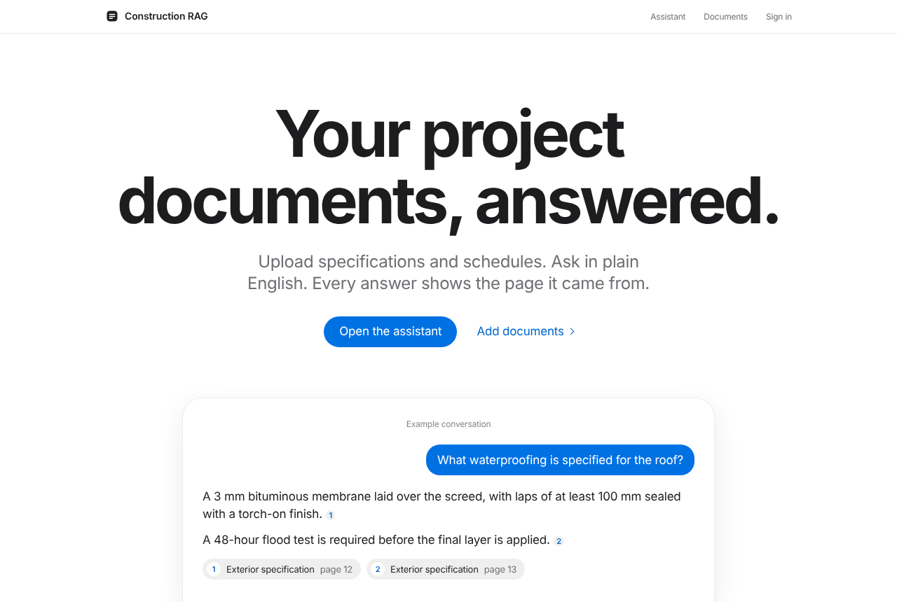
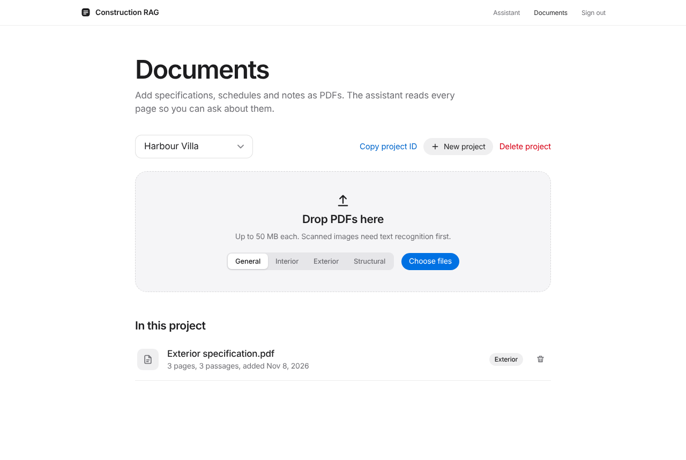
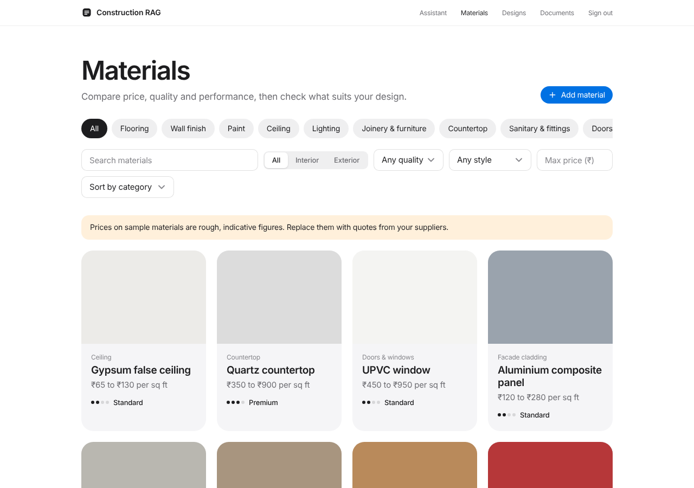

# Construction RAG Assistant

Ask questions about construction documents and get answers that cite the page they came from. Upload specification PDFs for a project, tag them as interior, exterior or structural, and chat with them. Everything runs on your own computer: the language model is served locally by Ollama.



## What it does

- **Answers with sources.** Each answer cites numbered passages `[1]`, and every citation opens the exact text, document and page it came from.
- **Hybrid retrieval.** Vector search (sentence embeddings in ChromaDB) is combined with BM25 keyword search using reciprocal rank fusion, so exact terms such as clause numbers and material codes are found as reliably as paraphrased questions.
- **Honest "not found".** If nothing in the project is relevant enough, the assistant says so without calling the model, which avoids invented specifications.
- **Interior and exterior.** Documents are tagged by type. Questions are routed to the right set automatically, or you can choose Interior, Exterior or Structural.
- **Follow-up questions.** The last 5 turns are remembered, and follow-ups such as "what about its thickness?" are rewritten into standalone questions before searching.
- **Streaming and concurrency.** Answers stream word by word. Several people can ask at once: questions run through a queue (2 at a time by default) so the local model is never overloaded, and the Stop button cancels generation.
- **Accounts and roles.** JWT sign-in with `admin`, `engineer` and `user` roles. Only admins and engineers can add or remove documents. The first account created becomes the admin.
- **Conversation history** per project, with delete, stored in MongoDB.





## Materials and designs

Besides answering questions, the app helps clients choose materials and see whether they suit a design.

**Materials catalogue.** Each material has a category, brand and model, styles, sizes, a price range per unit (in rupees), a quality grade (economy, standard, premium, luxury), ratings for durability, water resistance, weather resistance and ease of upkeep, an about text with strengths and cautions, and photos. Visitors can search, filter by category, setting, quality, style and price, and sort. Administrators and engineers add and edit materials and upload photos. Without a photo, a card shows the material's colour.

**Designs.** A design is a room or a facade: its setting (interior or exterior), style, area, budget, quality target, and whether it is a wet area or has heavy traffic. Each design holds:

- a blueprint (floor plans and elevations as images or PDFs),
- reference images of the look the client wants,
- the components: the materials chosen, with size and quantity, priced from the catalogue.

**Fit check.** Open any material and pick a design, or add a material to a design, and the app checks it and explains the result in plain words:

| Check | Fails or warns when |
| --- | --- |
| Setting | An interior-only material is used outside (fail) |
| Style | The material's styles don't include the design's style (note) |
| Quality | The grade is below the design's target (note); above it is fine |
| Water | The design is a wet area and water resistance is low |
| Weather | The design is exterior and weather resistance is low |
| Wear | The design has heavy traffic and durability is low |
| Size | The chosen size isn't one of the sizes offered (note) |
| Budget | The cost range can't fit the budget (fail), or only the upper end exceeds it (note) |

The verdict is "Fits your design", "Fits with a few notes" or "Not a good match". Costs come from the price range times the quantity (or the design's area for per-sq-ft and per-sq-m materials), and the design page totals them by category against the budget.

**Design proposal PDF.** Every design page has a **Download PDF** button (available to clients too). The PDF contains:

- a cover with the design's requirements, the estimated cost against the budget, and a palette of the chosen materials,
- "Your design in plain words": what the design is, what was chosen, what it will cost, which materials fit, what needs attention, and suggested next steps,
- a cost chart by category against the budget, a priced table of every material, and a short guide to reading the numbers and verdicts,
- the blueprint images and reference images, and any PDF drawings attached at the end with their page numbers,
- one page per material with its photo, price and quality, ratings, the fit checks, and an about section.

The explanations are written from the catalogue and the fit checks, not by the language model, so they never invent prices or claims. Images (including WebP) are converted and shrunk automatically.

The first time, an administrator can click "Load sample materials" on the Materials page. **These prices are rough, indicative figures, not market quotes.** Replace them with your suppliers' prices. Photos and drawings are stored in `server/uploads/media` and served from `/files` under random file names. The PDF uses the open-source Inter font, included in `server/assets/fonts` with its licence.

## Architecture

```
client/        Next.js app: landing, sign in, assistant, documents, materials, designs
server/        Express API: auth, projects, documents, chat (Server-Sent Events), request queue,
               materials, designs, fit and cost rules (lib/fit.js)
rag_service/   Python FastAPI service: ingestion, hybrid retrieval, prompting, Ollama streaming
```

Browser, then Express (`:5000`) with MongoDB for users, projects, documents and chats, then the Python service (`:8000`) with ChromaDB and Ollama (`:11434`).

## Requirements

- Node.js 20 or newer
- Python 3.10 to 3.12 recommended (very new Python versions can lack wheels for some packages)
- MongoDB running locally, or a MongoDB Atlas connection string
- [Ollama](https://ollama.com) with a chat model: `ollama pull llama3.2`

## Run it

Use three terminals. Commands are for PowerShell; on macOS or Linux use `cp` instead of `Copy-Item` and `source venv/bin/activate` to activate the environment.

**1. Python service**

```powershell
cd rag_service
python -m venv venv
venv\Scripts\Activate.ps1
pip install -r requirements.txt
uvicorn app:app --port 8000
```

The first start downloads the embedding model (about 90 MB) and then loads it. Wait for "Embedding model ready."

**2. API**

```powershell
cd server
npm install
Copy-Item .env.example .env
npm run dev
```

Open `server/.env` and set `JWT_SECRET` to a long random string. Keep `RAG_URL` as `http://127.0.0.1:8000` (not `localhost`, which can resolve to IPv6 and be refused).

**3. Web app**

```powershell
cd client
npm install
npm run dev
```

Open http://localhost:3000, create an account (the first one is the admin), create a project on the Documents page, upload a PDF, and ask a question.

## Settings

| Where | Variable | Default | Purpose |
| --- | --- | --- | --- |
| server | `RAG_CONCURRENCY` | `2` | Answers generated at once |
| server | `CLIENT_ORIGIN` | `http://localhost:3000` | Allowed web app origin(s), comma separated |
| rag_service | `LLM_MODEL` | `llama3.2` | Ollama model for answers |
| rag_service | `MAX_DISTANCE` | `0.75` | How close a passage must be to count as relevant (lower is stricter) |
| rag_service | `TOP_K` | `5` | Passages given to the model |
| rag_service | `OLLAMA_URL` | `http://127.0.0.1:11434` | Where Ollama runs |
| client | `NEXT_PUBLIC_API` | `http://localhost:5000/api` | API address |

Set Python variables in the terminal before starting, for example `$env:LLM_MODEL="mistral"` in PowerShell.

## Measure retrieval quality

Write 30 to 50 questions with known answers (see `rag_service/eval_questions.example.json`), then:

```powershell
cd rag_service
python evaluate.py PROJECT_ID eval_questions.json
```

It prints hit rate at 1 and at k, mean reciprocal rank, and the questions it missed. Use "Copy project ID" on the Documents page to get the id. Change `MAX_DISTANCE`, `TOP_K` or chunk sizes and run it again to see what helps.

## Tests

```powershell
cd server
npm test
```

The server tests cover the fit rules, cost totals, input checks, the plain-language explanations and PDF generation.

```powershell
cd rag_service
pip install -r requirements-dev.txt
python -m pytest
```

The tests cover chunking, tokenizing, domain detection, hybrid retrieval, domain filtering, the "not found" path and prompt building. They use a small stand-in for the embedding model, so nothing is downloaded.

## Roles

New accounts are `user` (can ask questions). To make someone an engineer or admin:

```
mongosh
use construction_rag
db.users.updateOne({ email: "person@example.com" }, { $set: { role: "engineer" } })
```

Use the database name from your `MONGO_URI`.

## Troubleshooting

- **`npm install` fails on `sharp`**: it downloads a small prebuilt image library. Check your internet or proxy, then try again.
- **Material photos don't appear**: check that the API is running and that `NEXT_PUBLIC_API` points to it; photos load from the same address under `/files`.
- **"The document service isn't running"**: start `uvicorn app:app --port 8000` in `rag_service`.
- **"Ollama isn't running" or "model isn't installed"**: open the Ollama app and run `ollama pull llama3.2`.
- **Upload says no readable text**: the PDF is a scan. Run OCR on it first.
- **Answers say "I couldn't find that"** for things that are in the documents: raise `MAX_DISTANCE` slightly (for example `0.85`) and check with `evaluate.py`.
- **Sign-in page says it can't reach the server**: check that the API is running and `NEXT_PUBLIC_API` points to it.
